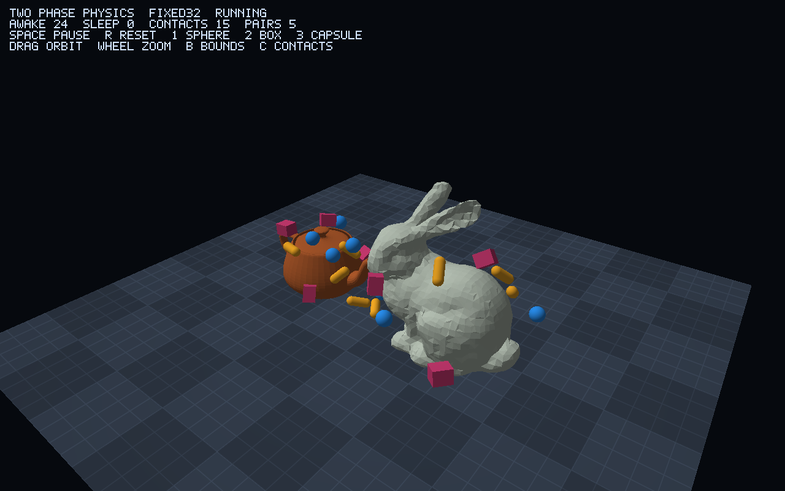

# Example rigid-body physics

[`examples/physics`](../examples/physics/mod.rs) is a small Newton-inspired
rigid-body example built on the [collision module](collision.md). The simulation
is independent of windowing/rendering and runs in f32, native S15.16/i32 or
native S31.32/i64. All simulation arithmetic uses the selected scalar; scene
setup and rendering conversions are separate.

Run the shared teapot/bunny scene without a display:

```sh
cargo run --release --example physics_headless -- f32 1200
cargo run --release --example physics_headless -- fixed32 1200
cargo run --release --example physics_headless -- fixed64 1200
```

The scene contains 24 dynamic spheres, oriented boxes and capsules, the static
teapot/bunny triangle soups, and a tiled floor 32 units wide. The model fixtures are
uniformly scaled to a longest extent of eight and placed upright on the floor.
The floor uses four-unit tiles so the existing segment/triangle kernels' quartic
intermediates remain bounded for S15.16. Mesh construction/setup allocates once;
tick scratch vectors retain their capacities.

## SDL2 + glow GLES3 demo

```sh
cargo run --release --features physics-demo --example physics_demo -- --scalar fixed32
```

Choose `f32`, `fixed32` (S15.16) or `fixed64` (S31.32) at launch. The optional
`physics-demo` feature enables glow 0.18 and SDL2 0.38, using the system SDL2
development package through pkg-config. A GLES3-capable driver is required.
SDL explicitly requests the OpenGL ES profile, version 3.0; the renderer checks
the actual context and compiles GLSL ES 3.00 shaders. Headless physics and normal
library/no_std builds do not require SDL2 or GL.



The renderer derives primitive dimensions and transforms directly from each
body and uploads the same immutable triangles used by its collision trees.
Static meshes are shaded, the floor has a procedural grid, and a built-in bitmap
HUD shows the scalar backend, motion counts, contacts and broad-phase pairs.
GPU resources have explicit ownership and are destroyed before SDL's context.

| Input | Action |
| --- | --- |
| Left drag / right drag | Orbit / pan camera |
| Mouse wheel | Zoom |
| Space / N | Pause/resume / advance one tick |
| R | Reset the scene |
| 1 / 2 / 3 | Launch a sphere / box / capsule toward the scene |
| B / C | Toggle body AABBs / contact normals |
| Escape | Exit |

Interactive rendering accumulates elapsed time for fixed 120 Hz simulation,
with at most eight catch-up ticks per frame. A finite run advances exactly two
ticks per frame and disables vsync, allowing reproducible driver smoke tests:

```sh
cargo build --release --features physics-demo --example physics_demo
SDL_VIDEODRIVER=offscreen target/release/examples/physics_demo \
  --scalar fixed32 --frames 120 --hidden --capture /tmp/physics.ppm
```

The offscreen driver depends on the local SDL/EGL installation. Capture reads
the final back buffer before swapping, using GLES' supported RGBA byte format,
checks GL errors, and writes a top-down RGB PPM file. `--capture` applies when
the `--frames` limit is reached. The committed screenshot is from this real
fixed-point render path, converted from PPM to PNG with FFmpeg.

## Tick and ownership contracts

`World::step()` advances one represented 1/120-second tick:

1. Semi-implicit Euler integrates gravity and bounded velocities, then updates
   and normalizes orientation quaternions.
2. Broad phase insertion-sorts the previous X sweep order, rejects disjoint
   Y/Z intervals, and visits **all** overlapping static-tree leaf candidates.
   It produces typed body pairs or stable mesh/triangle IDs, without contacts.
3. Narrow phase reuses existing overlap kernels and generates contact points,
   B-to-A unit normals and penetration depths. Analytic rounded-shape witnesses,
   SAT, clipped polygons and spread-point reduction cover every convex pair and
   sphere/capsule/box versus triangle. Four-point manifolds support box faces.
4. Twelve accumulated sequential-impulse passes solve restitution and a two-axis
   Coulomb friction disk. Previous local anchors and normal agreement warm-start
   impulses; tangent impulses are transformed into the new contact basis.
5. Four split position passes remove penetration without adding correction
   velocity. Seam points merge, and each body/object pair retains at most eight
   deepest constraints. Damping and static-supported quiet ticks drive sleeping.

Tree splits break equal center keys by original triangle ID, and each leaf
visits IDs in ascending order. Before contact reduction, candidates sort by
variant and stable body/mesh/triangle IDs. Reduced constraints sort by owner and
their full represented geometric/solver values before sequential impulses.
These total orders remove dependence on standard-library partition layout,
broad-phase visitation order and tree leaf size. Triangle input order remains
part of the scene's identity. This changes trajectories from the initial demo,
whose solver inherited traversal order; it preserves the collision contracts.

Bodies own immutable dimensions, mass/inertia and controlled pose/velocity state.
Their world-local IDs are append-only and remain stable until reset. There is
no per-body removal/reuse and the demo limits capacity to 128. Static trees own
immutable world-space triangles, shared by collision and rendering consumers.
No global state, runtime numeric-policy switch or untyped collider payload exists.

Construction validates dimensions, material, mass, finite pose and normalized
orientation. Mass reciprocals and inverse-inertia divisions are checked and use
the same native quantization as ordinary arithmetic. Shape-inertia intermediates
and stepping still require the caller to keep every intermediate representable.

The current example constructor enforces dimensions 0.1–4 units, capsule
centerline half-length 0–4, and mass 0.1–10; the example world bounds centers to
±24. These are heuristic scene limits chosen for the initial S15.16 workload,
not fundamental physics limits or a derived overflow guarantee. They also apply
to f32/f64 even though those backends have different working ranges.

Small masses/radii produce large inverse inertia: a sphere has
`I^-1 = 5 / (2 * mass * radius^2)`. Large dimensions/coordinates increase collision
intermediates, and tiny features can be poorly resolved by S15.16's 1/65,536
quantum. An accepted input can still overflow a later product; finite values and
these thresholds do not prove safety for every contact configuration.

For a reusable general engine, body construction should validate positive finite
physical inputs and use checked, representable mass/inertia preparation. Scene
size limits and escape boundaries belong in demo configuration. That separation
is the intended generalization; the current example still enforces the limits
above. Other geometry/scales require their own range analysis.

`Awake` accumulates quiet ticks only with immutable mesh support whose normal
opposes gravity (any static contact at zero gravity) and **no body/body contact**;
90 transitions to `Sleeping`. Dynamically touching bodies stay active, so a
support sliding away cannot leave an asleep body suspended. Any body contact
wakes both participants before preparing contact masses, including slow or
angular-only contact. External velocity/impulse commands also wake the body.

An effective gravity change wakes all enabled bodies before their next
integration and resets quiet counters. Identical gravity preserves them;
nonfinite gravity is rejected without changing force or motion state. A center
outside ±24 becomes `Disabled`, is omitted from collision/rendering and rejects
motion commands. Resetting the whole world starts a fresh ID domain. The floor
is finite: bodies can roll off its edge and subsequently leave the world.

This conservative rule replaces the original per-body dynamic-support sleep
optimization. Sleeping stacks would require a continuous support/island lifecycle;
one-time waking on external mutation is insufficient because a dependent can
resleep before slow support motion separates it. The bounded example keeps
stacks active instead of introducing that graph. This trades additional stack
work for a smaller, explicit lifecycle while retaining isolated floor/mesh sleep.

`Stats` reports candidate pairs, tree bounds/triangle work, reduced contacts and
motion states for the completed tick. The headless runner also checks every
body's represented pose and velocity for nonfinite values. Deterministic ticks
repeat within one backend; different scalar quantization produces different
trajectories and contact decisions.

The [raw replay and determinism contract](physics-determinism.md) fixes starting
inputs and tick-indexed commands and checks full state fingerprints, including
sleep counters and both impulse buffers. Both fixed formats match all 1,441
reference states on native x86-64, emulated ARMv5TE and emulated RISC-V64.
Interactive camera/frame timing is outside that contract; applications must
quantize and schedule external inputs identically to obtain matching ticks.

This example uses discrete contacts and two-sided triangle surfaces. It does
not provide CCD, joints, deformables, dynamic concave meshes, exact predicates,
solid containment tests, or production-grade arbitrary-scale stability.

## Full simulation benchmarks

```sh
cargo build --release --example physics_bench
taskset -c 0 target/release/examples/physics_bench 1200 5 9
```

Arguments are ticks per trajectory, batches per sample, and samples; all must be
positive. `taskset` is an optional Linux CPU-affinity tool. This measures the full
`World::step()` CPU pipeline above, including integration, quaternion updates,
both collision phases, warm starts, all twelve velocity/four position passes,
damping and sleep accounting. Rendering, tree/scene construction, frame conversion,
state restoration, warm-up and finite/end-state checks are outside the timers.
Both backends include the same work-counter accumulation. Scratch storage is warm
and reused; the benchmark does not measure cold-start allocations.

On an Intel Core Ultra 7 155H, x86-64 Linux, pinned logical CPU 0, using rustc
1.98.1 / LLVM 22.1.8 with default release settings (2026-11-08):

| Full-step workload | f32, µs/tick median [min, max] | S15.16, µs/tick median [min, max] | S15.16 / f32 time |
| --- | ---: | ---: | ---: |
| Native trajectories | 51.79 [51.07, 53.05] | 84.99 [83.93, 86.93] | 1.641× |
| Shared S15.16 pre-step states | 65.00 [64.22, 65.94] | 84.33 [83.75, 86.16] | 1.297× |

Each sample measures five 1,200-tick trajectories (ten nominal simulated seconds
each), with nine samples and alternating f32/fixed measurement order. The scene
has 24 spheres/boxes/capsules, 6,320 teapot triangles, 3,851 bunny triangles and
128 floor triangles. The native medians consume about 0.62% and 1.02% of a
120 Hz tick's 8,333 µs budget on this host. These are average costs over this
scene's fall/contact/settling sequence, not worst-case frame latency or estimates
for other body counts, scenes or processors.

Native trajectories use each backend's ordinary setup and represented timestep.
They diverge as contacts, quantization, sleep and escape decisions accumulate.
The native S15.16 run does more collision work, so its 1.641× time ratio does not
isolate arithmetic cost:

| Mean work per tick | Native f32 | Native S15.16 | Shared-state f32 | Shared-state S15.16 |
| --- | ---: | ---: | ---: | ---: |
| Dynamic candidate pairs | 4.388 | 4.070 | 4.071 | 4.070 |
| Static triangle candidates | 131.853 | 186.993 | 186.965 | 186.993 |
| Tree bounds tested | 688.819 | 847.180 | 847.106 | 847.180 |
| Reduced solver contacts | 27.999 | 33.328 | 33.422 | 33.328 |
| Awake bodies | 18.475 | 19.738 | 19.738 | 19.738 |
| Sleeping bodies | 5.072 | 4.263 | 4.263 | 4.263 |
| Disabled bodies | 0.453 | 0.000 | 0.000 | 0.000 |

The shared-state comparison records every S15.16 pre-step state, then restores
it before each timed full step in both backends. f32 receives exactly dequantized
body poses, cached orientation axes, velocities, prepared mass/inertia, motion
counters, both contact/impulse buffers, sweep order and configuration, including
the S15.16 timestep/tolerances. Untimed checks reject any shared component that
f32 cannot represent exactly. Static trees are rebuilt once from the same
represented input triangles and original IDs. Tree layout and the next contact
decisions can still differ with arithmetic; the work table exposes that difference.
This is a sequence of complete steps from shared inputs, not a sustained native
f32 trajectory or a scalar-operation microbenchmark.

Shared-state measurements include a clock interval per step; the measured empty
interval averaged 12.63 ns, included without subtraction. Native measurements
use one interval per complete trajectory. Repeated samples must have identical
work counts and final represented body values within each backend/workload.
The restoration regression also compares complete fixed-state fingerprints to
uninterrupted execution. Neither timing nor trajectory divergence establishes
simulation accuracy. S15.16 is slower on this host even for the closely matched
shared inputs; fixed arithmetic does not imply a speed advantage on an FPU-equipped
processor. ARMv5/RISC-V replay checks establish deterministic results, not hardware
performance measurements.

See [raw measurements and build metadata](benchmarks/physics-x86_64.txt).

## Regression coverage

`cargo test --test physics_examples` covers all shape pairs, misses, contact
normal direction, coincident capsule centerlines, four-point box faces,
all-candidate traversal, sweep versus
an exhaustive pair oracle, floor settling on all three backends, restitution
and momentum, friction, angular impulses, stacked boxes, sleeping/waking,
terminal disabled bodies, construction/capacity and repeated fixed ticks.
Slow-support regressions run 1,200 ticks after a 0.14-unit/s support velocity
change, exceeding the quiet window. Gravity reversal, unchanged/rejected gravity,
side-wall contacts, zero-speed dynamic contacts and disabled-body force changes
exercise the sleep eligibility and mutation boundaries.
Partition-permutation tests cover coincident split keys and five leaf sizes;
a dense six-box test reverses/rotates candidate visitation for 180 ticks and
compares raw poses, velocities and warm impulses against the normal pipeline.

Implementation validation also ran offline all-target tests with `physics-demo`,
fixed-only tests, libm all-target checks, formatting and documentation with
warnings denied. Each backend completed 1,200 headless ticks with finite pose
and velocity checks. On SDL2 2.32.10 / Mesa 26.0.8, each backend rendered 120
offscreen frames in an actual OpenGL ES 3.2 context without a GL error; fixed32
also exercised screenshot readback. These runs validate this bounded scene,
not arbitrary scales or identical trajectories across scalar backends.
